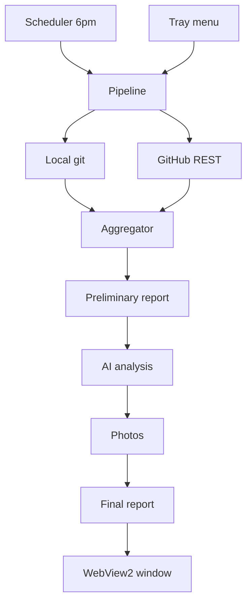
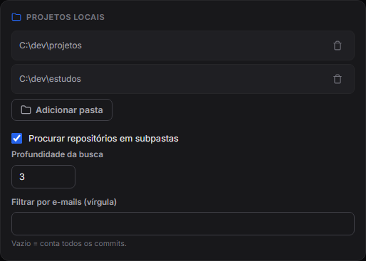
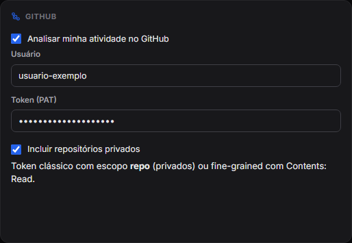
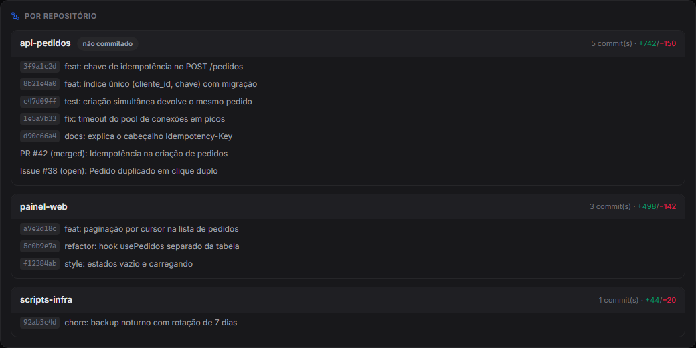
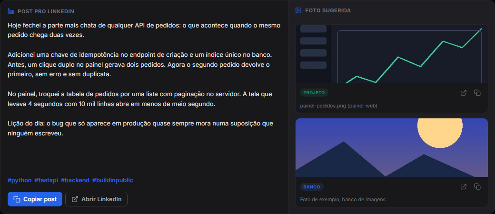
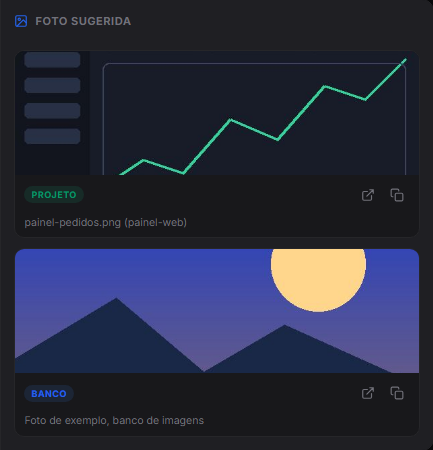
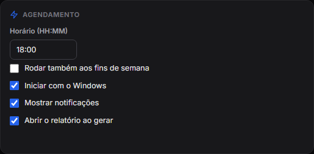
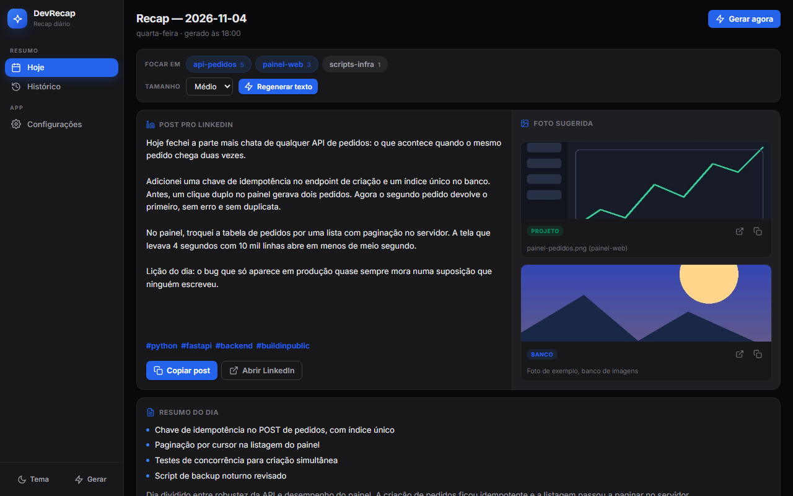
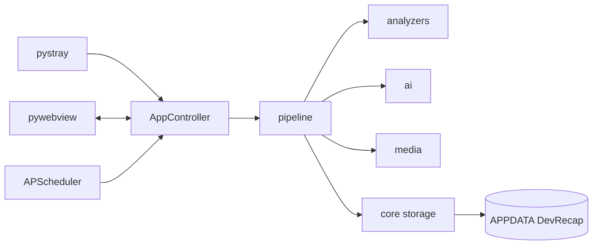

<p align="center"></p>

<h1 align="center">DevRecap</h1>

<p align="center">Windows tray app that summarizes your coding day and drafts a post from it.</p>

<p align="center">
  <kbd> Python</kbd> <kbd> PyInstaller</kbd> <kbd> APScheduler</kbd> <kbd> WebView2</kbd> <kbd> Claude Code</kbd> <kbd> GitHub API</kbd>
</p>

<p align="center"><a href="./README.md"><kbd>Português</kbd></a> <kbd><b>English</b></kbd></p>

<table>
<tr>
<td align="center" width="33%"><b>6:00 PM</b><br><sub>runs every day</sub></td><td align="center" width="33%"><b>3 outputs</b><br><sub>list, summary and post</sub></td><td align="center" width="33%"><b>Windows</b><br><sub>10 and 11, no admin</sub></td>
</tr>
</table>

### Overview

DevRecap is a Windows tray app written in Python that wraps up your development day on its own. Every day at 18:00 it reads the commits from your local folders through git and your GitHub activity through the REST API, merges both sources and produces a report: the list of what was done, a summary with technologies and progress, a LinkedIn post idea and photo suggestions. The interface is HTML and CSS inside a WebView2 window, with light and dark themes. Data lives in `%APPDATA%\DevRecap`, autostart needs no administrator rights and the app ships as an `.exe` built with PyInstaller.

### How it works

1. The scheduler wakes at the configured time (default 18:00, weekdays only) or you pick "Generate recap now" from the tray menu.
2. The local collector scans the marked folders for repositories and reads, with the git CLI, the day's commits, changed lines, files and uncommitted changes.
3. The GitHub client lists repositories with a recent push, fetches your commits of the day and the PRs and issues opened or merged.
4. The aggregator matches local repositories with GitHub ones and produces a single activity for the day.
5. The pipeline writes a preliminary report to disk and calls the AI analysis, which reads that report and returns summary, technologies, progress, highlights, post, hashtags and photo keywords.
6. The media module looks for images in your own projects and, if you have a key, in Pexels or Unsplash.
7. The final report is saved as JSON and Markdown, the window shows the result and a notification says it finished.



### Features in detail

#### Local collection with git

Each marked folder is scanned down to a configurable depth (default 3), never descending into a repository already found and skipping `node_modules`, `dist`, `build`, virtual environments and similar.

<p align="center"><br><sub>Settings: scanned folders, search depth and author email filter.</sub></p>

- It runs `git log --no-merges` between 00:00 and 23:59 of the local day, using the commit date so it matches the window filter.
- It asks for the full message body (`%B`), because that is where the reasoning of a commit lives. Since the body spans several lines, records are separated by control characters instead of line breaks.
- For each commit, `git show --numstat` returns added and removed lines, touched files and the count per extension, which becomes the language map.
- `git status --porcelain` flags uncommitted work. A repository enters the report if it has commits or pending changes.
- Commits can be filtered by author e-mail. Git calls run without opening a console window, a detail that matters in a tray app.

#### GitHub activity

- It lists `/user/repos` sorted by `pushed_at` and stops paginating once it passes the day boundary, computed in local time and converted to UTC.
- For each active repository, it fetches your commits in the day's interval, with the link of each one.
- Three `/search/issues` queries bring PRs created, PRs merged and issues created that day, attached to the right repository.
- On a rate limit, it honors `Retry-After` or `X-RateLimit-Reset` and sleeps at most 120 seconds before trying again. Per-repository failures become warnings in the report without stopping the collection.

<p align="center"><br><sub>GitHub settings: username, token and the option to include private repositories.</sub></p>

#### Aggregation

The aggregator matches each local repository with its GitHub counterpart by normalized `remote_url` (no scheme, no `.git`) and, failing that, by name. For a pair it merges commits without duplicating by SHA, merges PRs and issues, sums the stats and marks the source as "both". The dirty-tree state comes from the local side.

<p align="center"><br><sub>Per-repository detail: commits, PR and issue merged, with lines added and removed.</sub></p>

#### AI analysis and post

This step reads the preliminary report and returns an object with summary, technologies, progress, added value, highlights, post, hashtags and photo keywords.

<p align="center"><br><sub>Generated LinkedIn post with hashtags, next to the suggested photos.</sub></p>

- Instead of an API call, the step runs Claude Code in headless mode (`claude -p`), with the prompt sent over stdin. The agent can read files and open commits, which a single prompt cannot hold.
- It runs with `acceptEdits` and extra directories granted through `--add-dir`, the minimum scope to write the result with nobody around to approve.
- It has a 15-minute ceiling, and a failure never takes the recap down: the report stays valid with the git activity and the error shows on screen.
- You choose the language, the tone and the post length (short, medium or long), and can point to a style reference file.

#### Media and photos

- Project photos: it scans local repositories for images, ignores build and dependency folders and files under 5 KB (except SVG). It scores by name (`screenshot`, `banner`, `hero`, `demo`), by folder (`docs`, `assets`, `public`), by match with the keywords and by recency.
- Photo bank: Pexels or Unsplash, searching by the keywords, downloading locally and keeping the photographer attribution alongside. On Unsplash, the download endpoint is triggered as the guidelines ask.
- The order of preference is a real image from the project, then the photo bank.

<p align="center"><br><sub>Suggested photos, with the source of each one (project or stock library).</sub></p>

#### Window, tray and scheduler

- The window has three areas: Today (post and photo side by side, summary, numbers and per-repository detail), History and Settings.
- In Today, the day's repositories become chips: tick the ones that count, pick the text size and regenerate without recollecting commits.
- Closing the window only hides it. The tray menu opens the app, generates the recap, opens settings, toggles autostart and quits.
- The light or dark theme remembers your choice and, without one, follows the system.

<p align="center"><br><sub>Scheduling settings: daily time, weekends, start with Windows and notifications.</sub></p>

<p align="center"><br><sub>Today tab in the dark theme: per-repository focus, post and photo side by side, summary.</sub></p>

### Architecture

- `app.py`: the controller. It joins window, tray and scheduler, and exposes the API to JavaScript.
- `pipeline.py`: the flow of collection, aggregation, AI, photos and saving.
- `analyzers/`: local git, GitHub client and aggregator.
- `ai/`: the bridge to Claude Code.
- `media/`: project photos and the photo bank.
- `scheduler/`: the daily schedule with APScheduler.
- `ui/`: tray icon, webview bridge and the frontend in `web/`.
- `core/`: models, settings, paths, storage, autostart and clipboard.



Where the data lives, all under `%APPDATA%\DevRecap`: `config.json` with settings and keys, `reports/YYYY-MM-DD/` with `report.json` (source of truth) and `report.md`, `media/` with downloaded images and `logs/devrecap.log`.

### Engineering decisions

1. **Write the report before the AI.** The analysis reads `report.json` from disk, so the pipeline saves a preliminary one with the git activity and only then calls the AI. If the AI fails, the recap stays valid.
2. **Nothing leaks to the orchestrator.** Each module catches its exception, logs it and returns a partial object with an error field. A broken repository becomes a warning, not a crash.
3. **Agent instead of a single prompt.** Commits with full bodies and diffs do not fit well in one prompt. Running Claude Code headless trades speed (minutes) for context, which is why the work runs in the background.
4. **Separate threads.** The window loop owns the main thread, the tray runs on a daemon thread and the pipeline on its own thread, with the result pushed to JavaScript.
5. **Registry autostart, no admin.** The `HKCU\...\Run` key works both from source and from the frozen `.exe`.
6. **Executable self-test.** `--selftest` validates imports, icon, scheduler and pipeline with an isolated `APPDATA`. In a `--windowed` app an import failure would be silent.

### Privacy

- Settings, reports, images and logs stay on your machine, in `%APPDATA%\DevRecap`. The GitHub token and the photo bank key sit in plain text in `config.json`, outside the repository and listed in `.gitignore`.
- To GitHub go your username and token, in the API calls. To Pexels or Unsplash go the key and the search keywords.
- Reading local commits uses the installed git. The report content is handed to the Claude Code CLI installed on the machine, which processes it as that tool works.
- Sensitive projects stay out if they are not in the monitored folders.

### Known limits

- Windows 10 or 11 only, with Python 3.11 or newer, WebView2 and git on PATH.
- The analysis depends on the Claude Code CLI and on an instruction file from the author's project; without them the app lists the activity but produces no summary or post.
- The analysis takes minutes and has a 15-minute ceiling.
- On Unsplash, demo mode allows 50 requests per hour. Pexels gives the key instantly.
- Private GitHub repositories need a token with the `repo` scope (or Contents: Read, on fine-grained tokens).
- Pexels and Unsplash require crediting the photographer; the post should include it when using a bank photo.
- The README suggests excluding the `.venv` folder from OneDrive sync.

### Requirements and installation

- Windows 10 or 11 with the WebView2 Runtime, Python 3.11 or newer and `git` on the PATH.
- Claude Code installed: the daily analysis runs through the CLI in headless mode.

```powershell
.\setup.ps1                          # creates the .venv and installs dependencies
.\.venv\Scripts\pythonw.exe run.py   # runs without a console
.\build.ps1                          # optional: builds dist\DevRecap.exe with PyInstaller
```

On first run the Settings window opens by itself.

<sub>Contact: <a href="https://joaocouto.alcetus.com">joaocouto.alcetus.com</a> · <a href="mailto:joaopecouto77@gmail.com">joaopecouto77@gmail.com</a></sub>
