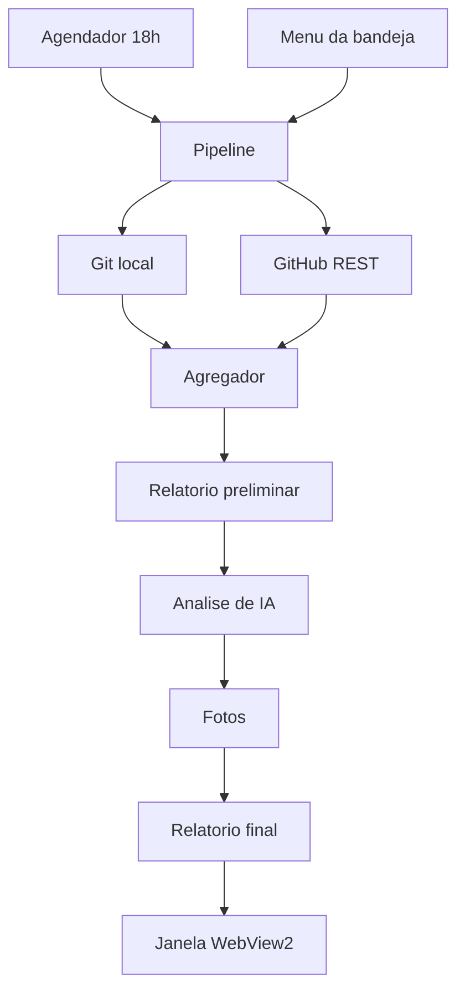
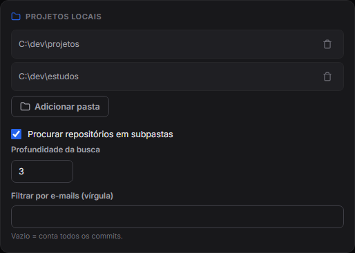
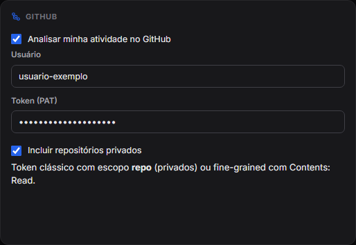
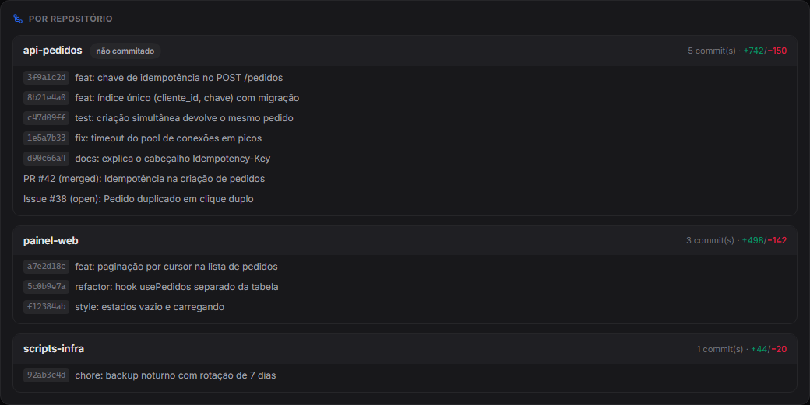
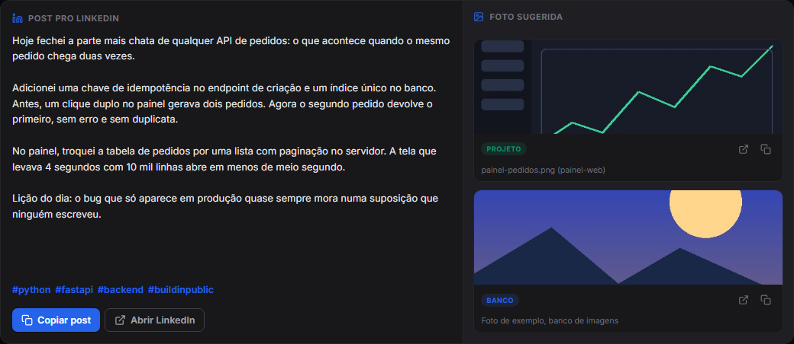
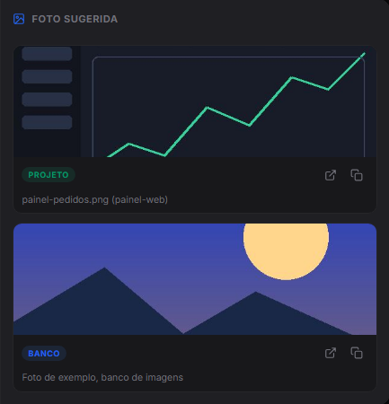
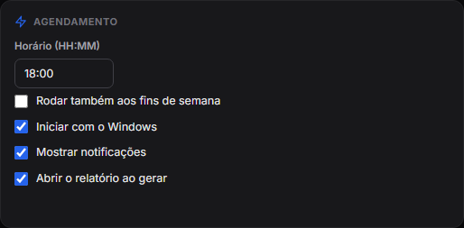
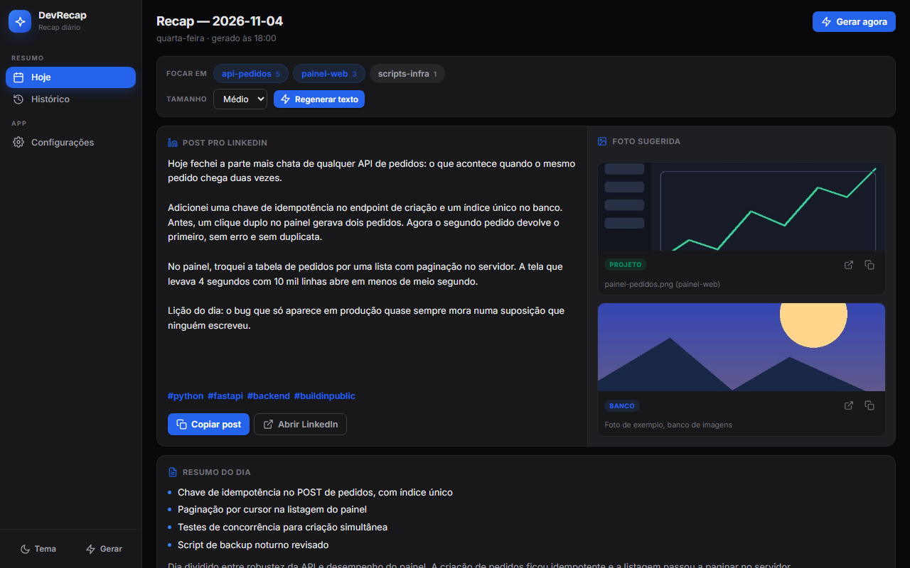
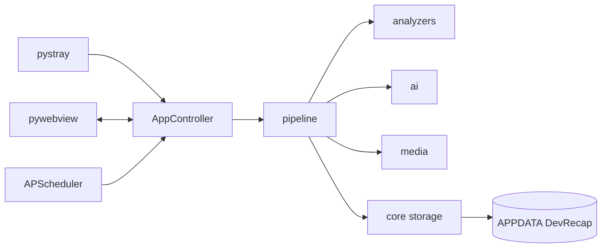

<p align="center"></p>

<h1 align="center">DevRecap</h1>

<p align="center">App de bandeja do Windows que resume o seu dia de código e prepara um post a partir disso.</p>

<p align="center">
  <kbd> Python</kbd> <kbd> PyInstaller</kbd> <kbd> APScheduler</kbd> <kbd> WebView2</kbd> <kbd> Claude Code</kbd> <kbd> GitHub API</kbd>
</p>

<p align="center"><kbd><b>Português</b></kbd> <a href="./README.en.md"><kbd>English</kbd></a></p>

<table>
<tr>
<td align="center" width="33%"><b>18:00</b><br><sub>roda todo dia</sub></td><td align="center" width="33%"><b>3 saídas</b><br><sub>lista, resumo e post</sub></td><td align="center" width="33%"><b>Windows</b><br><sub>10 e 11, sem admin</sub></td>
</tr>
</table>

### Visão geral

O DevRecap é um app de bandeja do Windows, escrito em Python, que fecha o seu dia de desenvolvimento sozinho. Todo dia às 18:00 ele lê os commits das suas pastas locais pelo git e a atividade do GitHub pela API REST, junta as duas fontes e produz um relatório: a lista do que foi feito, um resumo com tecnologias e progresso, uma ideia de post para o LinkedIn e sugestões de foto. A interface é HTML e CSS dentro de uma janela WebView2, com tema claro e escuro. Os dados ficam em `%APPDATA%\DevRecap`, o autostart não pede administrador e o app vira um `.exe` com PyInstaller.

### Como funciona

1. O agendador acorda no horário configurado (padrão 18:00, só em dias úteis) ou você pede "Gerar recap agora" no menu da bandeja.
2. O coletor local varre as pastas marcadas atrás de repositórios e lê, com o git CLI, os commits do dia, as linhas alteradas, os arquivos e as mudanças não commitadas.
3. O cliente do GitHub lista os repositórios com push recente, busca seus commits do dia e as PRs e issues abertas ou mescladas.
4. O agregador casa os repositórios locais com os do GitHub e produz uma única atividade do dia.
5. O pipeline grava um relatório preliminar em disco e chama a análise de IA, que lê esse relatório e devolve resumo, tecnologias, progresso, destaques, post, hashtags e palavras-chave de foto.
6. O módulo de mídia procura imagens nos próprios projetos e, se houver chave, no Pexels ou no Unsplash.
7. O relatório final é salvo em JSON e Markdown, a janela mostra o resultado e uma notificação avisa que terminou.



### Funcionalidades em detalhe

#### Coleta local com git

Cada pasta marcada é varrida até uma profundidade configurável (padrão 3), sem descer dentro de um repositório já encontrado e pulando `node_modules`, `dist`, `build`, ambientes virtuais e similares.

<p align="center"><br><sub>Configurações: pastas varridas, profundidade da busca e filtro por e-mail de autor.</sub></p>

- Roda `git log --no-merges` entre 00:00 e 23:59 do dia local, usando a data de commit para casar com o filtro de janela.
- Pede o corpo completo da mensagem (`%B`), porque é nele que vive o raciocínio do commit. Como o corpo tem várias linhas, os registros são separados por caracteres de controle em vez de quebras de linha.
- Para cada commit, `git show --numstat` devolve linhas somadas e removidas, arquivos tocados e a contagem por extensão, que vira o mapa de linguagens.
- `git status --porcelain` marca trabalho não commitado. Um repositório entra no relatório se tiver commits ou mudanças pendentes.
- Dá para filtrar commits por e-mail de autor. As chamadas ao git saem sem abrir janela de console, detalhe que importa num app de bandeja.

#### Atividade do GitHub

- Lista `/user/repos` ordenado por `pushed_at` e para de paginar quando passa da fronteira do dia, calculada em horário local e convertida para UTC.
- Por repositório ativo, busca commits do seu usuário no intervalo do dia, com o link de cada um.
- Três buscas em `/search/issues` trazem PRs criadas, PRs mescladas e issues criadas no dia, anexadas ao repositório certo.
- Em rate limit, respeita `Retry-After` ou `X-RateLimit-Reset` e dorme no máximo 120 segundos antes de tentar de novo. Falhas por repositório viram avisos no relatório, sem derrubar a coleta.

<p align="center"><br><sub>Configurações do GitHub: usuário, token e opção de incluir repositórios privados.</sub></p>

#### Agregação

O agregador casa cada repositório local com o seu par do GitHub pelo `remote_url` normalizado (sem esquema, sem `.git`) e, na falta dele, pelo nome. No par, une commits sem duplicar por SHA, une PRs e issues, soma estatísticas e marca a origem como "both". O estado de árvore suja vem do local.

<p align="center"><br><sub>Detalhe por repositório: commits, PR e issue unidos, com linhas somadas e removidas.</sub></p>

#### Análise de IA e post

Esta etapa lê o relatório preliminar e devolve um objeto com resumo, tecnologias, progresso, valor agregado, destaques, post, hashtags e palavras-chave de foto.

<p align="center"><br><sub>Post de LinkedIn gerado, com hashtags, ao lado das fotos sugeridas.</sub></p>

- Em vez de uma chamada de API, a etapa executa o Claude Code em modo headless (`claude -p`), com o prompt enviado por stdin. O agente consegue ler arquivos e abrir commits, coisa que um prompt único não comporta.
- Roda com `acceptEdits` e diretórios extras liberados por `--add-dir`, o escopo mínimo para gravar o resultado sem alguém para aprovar.
- Tem teto de 15 minutos, e uma falha nunca derruba o recap: o relatório segue válido com a atividade do git e o erro aparece na tela.
- Você escolhe o idioma, o tom e o tamanho do post (curto, médio ou longo), e pode apontar um arquivo de referência de estilo.

#### Mídia e fotos

- Fotos do projeto: varre os repositórios locais atrás de imagens, ignora pastas de build e dependências e arquivos abaixo de 5 KB (exceto SVG). Pontua por nome (`screenshot`, `banner`, `hero`, `demo`), por pasta (`docs`, `assets`, `public`), por casamento com as palavras-chave e por recência.
- Banco de fotos: Pexels ou Unsplash, com busca pelas palavras-chave, download local e a atribuição ao fotógrafo guardada junto. No Unsplash, o endpoint de download é acionado como a diretriz pede.
- A ordem de preferência é a imagem real do projeto, depois o banco de imagens.

<p align="center"><br><sub>Fotos sugeridas, com a origem de cada uma (projeto ou banco de imagens).</sub></p>

#### Janela, bandeja e agendador

- A janela tem três áreas: Hoje (post e foto lado a lado, resumo, números e detalhe por repositório), Histórico e Configurações.
- Em Hoje, os repositórios do dia viram chips: marque os que entram, escolha o tamanho do texto e regenere sem recoletar commits.
- Fechar a janela só a esconde. O menu da bandeja abre o app, gera o recap, abre as configurações, liga o autostart e encerra.
- O tema claro ou escuro lembra a sua escolha e, sem ela, segue o sistema.

<p align="center"><br><sub>Configurações de agendamento: horário diário, fins de semana, início com o Windows e notificações.</sub></p>

<p align="center"><br><sub>Aba Hoje no tema escuro: foco por repositório, post e foto lado a lado, resumo.</sub></p>

### Arquitetura

- `app.py`: o controlador. Junta janela, bandeja e agendador, e expõe a API ao JavaScript.
- `pipeline.py`: o fluxo coleta, agregação, IA, fotos e gravação.
- `analyzers/`: git local, cliente do GitHub e agregador.
- `ai/`: a ponte com o Claude Code.
- `media/`: fotos do projeto e do banco de imagens.
- `scheduler/`: o agendamento diário com APScheduler.
- `ui/`: ícone da bandeja, ponte do webview e frontend em `web/`.
- `core/`: modelos, configuração, caminhos, armazenamento, autostart e área de transferência.



Onde ficam os dados, tudo em `%APPDATA%\DevRecap`: `config.json` com ajustes e chaves, `reports/AAAA-MM-DD/` com `report.json` (fonte da verdade) e `report.md`, `media/` com imagens baixadas e `logs/devrecap.log`.

### Decisões de engenharia

1. **Gravar o relatório antes da IA.** A análise lê o `report.json` do disco, então o pipeline salva um preliminar com a atividade do git e só depois chama a IA. Se a IA falhar, o recap continua válido.
2. **Nada vaza para o orquestrador.** Cada módulo captura a exceção, loga e devolve um objeto parcial com campo de erro. Um repositório quebrado vira aviso, não pane.
3. **Agente em vez de prompt único.** Commits com corpo completo e diffs não cabem bem num prompt só. Rodar o Claude Code headless troca velocidade (minutos) por contexto, e por isso o trabalho roda em segundo plano.
4. **Threads separadas.** O loop da janela ocupa a thread principal, a bandeja roda numa thread daemon e o pipeline numa thread própria, com resultado empurrado ao JavaScript.
5. **Autostart por registro, sem admin.** A chave `HKCU\...\Run` funciona tanto pelo código-fonte quanto pelo `.exe` congelado.
6. **Autoteste do executável.** `--selftest` valida imports, ícone, agendador e pipeline com um `APPDATA` isolado. Num app `--windowed` uma falha de import seria silenciosa.

### Privacidade

- Config, relatórios, imagens e logs ficam na sua máquina, em `%APPDATA%\DevRecap`. O token do GitHub e a chave do banco de fotos ficam em texto no `config.json`, fora do repositório e listado no `.gitignore`.
- Para o GitHub saem seu usuário e o token, nas chamadas da API. Para o Pexels ou o Unsplash saem a chave e as palavras-chave de busca.
- A leitura dos commits locais usa o git instalado. O conteúdo do relatório é entregue ao CLI do Claude Code, instalado na máquina, que o processa conforme o funcionamento dele.
- Projetos sensíveis ficam de fora se não estiverem nas pastas monitoradas.

### Limites conhecidos

- Só Windows 10 ou 11, com Python 3.11 ou mais novo, WebView2 e git no PATH.
- A análise depende do CLI do Claude Code e de um arquivo de instrução do projeto; sem eles o app lista a atividade, mas não gera resumo nem post.
- A análise leva minutos e tem teto de 15 minutos.
- No Unsplash, o modo demo permite 50 requisições por hora. O Pexels dá a chave na hora.
- Repositórios privados no GitHub exigem token com escopo `repo` (ou Contents: Read, no fine-grained).
- Pexels e Unsplash exigem crédito ao fotógrafo; o post deve incluí-lo ao usar foto de banco.
- O README sugere excluir a pasta `.venv` da sincronização do OneDrive.

### Requisitos e instalação

- Windows 10 ou 11 com WebView2 Runtime, Python 3.11 ou superior e `git` no PATH.
- Claude Code instalado: a análise do dia roda pelo CLI, em modo headless.

```powershell
.\setup.ps1                          # cria o .venv e instala as dependências
.\.venv\Scripts\pythonw.exe run.py   # roda sem console
.\build.ps1                          # opcional: gera dist\DevRecap.exe com PyInstaller
```

Na primeira execução, a janela de Configurações abre sozinha.

<sub>Contato: <a href="https://joaocouto.alcetus.com">joaocouto.alcetus.com</a> · <a href="mailto:joaopecouto77@gmail.com">joaopecouto77@gmail.com</a></sub>
